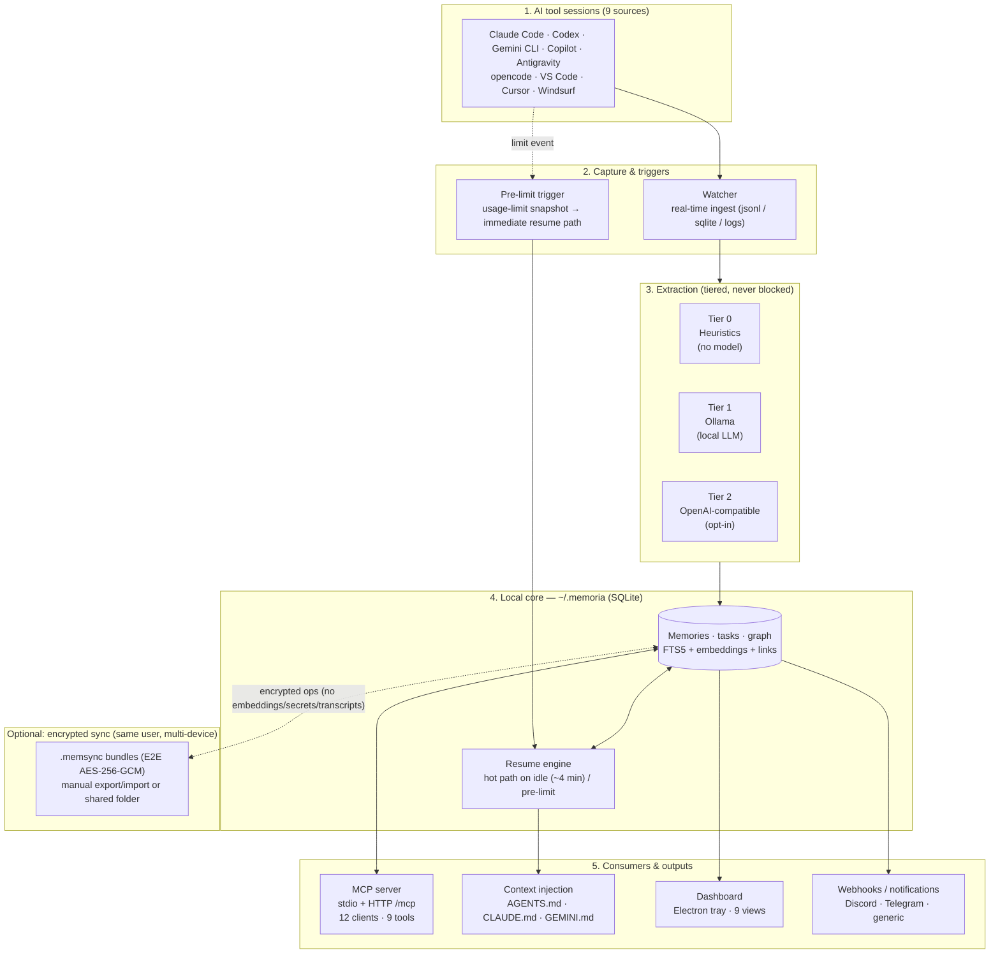

<div align="center">


# Memoria

**हर AI कोडिंग टूल के लिए एक "सेकंड ब्रेन" — 100% लोकल।**

Claude Code, Codex, Gemini CLI, Copilot, Antigravity, opencode, VS Code, Cursor, Windsurf —
एक साझा मेमोरी जो आपके किए हर काम को याद रखती है और अगले सेशन में उसे अपने-आप पहुँचा देती है।

कोई क्लाउड नहीं। कोई अकाउंट नहीं। आपके कंप्यूटर से कुछ भी बाहर नहीं जाता।

<br>


[](https://github.com/xinzzu/Memoria/releases)
[](https://github.com/xinzzu/Memoria/actions)
[](LICENSE)
[](https://hub.xerj.org/contributors/xinzzu)
[](https://www.npmjs.com/package/@xinzzu/memoria)
[](https://registry.modelcontextprotocol.io/v0/servers?search=io.github.xinzzu/memoria)
[](https://glama.ai/mcp/servers/xinzzu/Memoria)
[](https://mcprush.com/xinzzu/memoria-mcp)

[English](README.md) · [Bahasa Indonesia](README.id.md) · **हिन्दी**

```bash
npx @xinzzu/memoria@latest server   # then open http://127.0.0.1:48210
```


<sub>Claude Code में कैप्चर करें, Codex में जारी रखें: संदर्भ आपके साथ चलता है। अगर Memoria ने आपको दोबारा समझाने से बचाया, तो एक स्टार दूसरों को इसे खोजने में मदद करता है।</sub>

</div>

---

## क्यों?

हर AI टूल की याददाश्त कमज़ोर होती है। Claude को कल का सेशन याद नहीं रहता। Codex को नहीं पता कि आपने
Gemini CLI में "12-column grid" तय किया था। और जब काम के बीच में आपकी usage limit खत्म हो जाती है और आप
दूसरे टूल पर जाते हैं, तो सब कुछ फिर से समझाना पड़ता है।

**Memoria यह खाई भर देता है।** यह आपके AI टूल के सेशन देखता है, ज़रूरी बातें निकालता है — तथ्य,
निर्णय, टास्क, ठीक किए गए एरर — और उन्हें अगले सेशन तक, किसी भी टूल में, अपने-आप पहुँचा देता है।

इसे **limit-hopping** वर्कफ़्लो के लिए बनाया गया है: 14:30 पर limit खत्म हुई, 14:31 पर दूसरा टूल खोला —
और उसे पहले से पता है कि आप किस पर काम कर रहे थे।

---

## यह कैसे काम करता है



1. **कैप्चर** — किसी भी AI टूल में काम करें; Memoria सेशन (jsonl/sqlite/logs) को रियल-टाइम में देखता है और usage limit की सूचना मिलते ही एक निश्चित (deterministic) वर्क स्नैपशॉट लेता है।
2. **एक्सट्रैक्ट** — सक्रिय टियर (heuristics, Ollama, या OpenAI-compatible) ट्रांसक्रिप्ट को मेमोरी (तथ्य, निर्णय, टास्क, फ़िक्स) में बदलता है, जिन्हें FTS5 + embeddings + ग्राफ़ लिंक से इंडेक्स किया जाता है।
3. **लोकल स्टोर** — सब कुछ एक लोकल SQLite ब्रेन (`~/.memoria`) में रहता है; embeddings/dialects कभी अलग-अलग मॉडल के बीच मिलाए नहीं जाते।
4. **रिज़्यूम** — जब कोई सेशन निष्क्रिय हो जाता है (~4 मिनट) या pre-limit ट्रिगर होता है, तो resume engine सबसे नए सेशन को पहले एक्सट्रैक्ट करता है और `AGENTS.md` / `CLAUDE.md` / `GEMINI.md` में एक idempotent **SESSION RESUME** ब्लॉक डाल देता है।
5. **उपयोग** — 12 MCP क्लाइंट में से कोई भी stdio या HTTP ब्रिज (`/mcp`) के ज़रिए संदर्भ को `recall`/`remember`/क्यूरेट कर सकता है, जबकि डैशबोर्ड और opt-in webhooks वही स्थिति दिखाते हैं।
6. **सिंक (वैकल्पिक)** — end-to-end एन्क्रिप्टेड `.memsync` बंडल (मैन्युअल या शेयर्ड फ़ोल्डर) के ज़रिए अपने सभी डिवाइस पर लाइब्रेरी की प्रतिलिपि बनाएँ; embeddings, secrets, सेटिंग्स, ट्रांसक्रिप्ट और लोकल पाथ कभी सिंक नहीं होते।

## मुख्य विशेषताएँ

| | |
|---|---|
| 🔄 **9 टूल से कैप्चर** | Claude Code, Codex, opencode, Gemini CLI, Copilot, Antigravity, VS Code (Copilot Chat), Cursor, Windsurf |
| ⏸️ **Resume engine** | AGENTS.md / CLAUDE.md / GEMINI.md में अपने-आप डाला गया SESSION RESUME ब्लॉक: खुले टास्क, तय निर्णय, मौजूदा ब्रांच, बदली हुई फ़ाइलें |
| ⚡ **Pre-limit ट्रिगर** | जैसे ही आपका AI टूल usage limit बताता है, Memoria एक वर्क स्नैपशॉट (फ़ाइलें, कमांड, git स्थिति) कैप्चर करता है और आपके बाहर होने से **पहले** resume ब्लॉक **तुरंत** डाल देता है |
| 🧩 **MCP ब्रिज — एक URL, हर टूल** | `http://127.0.0.1:48210/mcp` पर HTTP के ज़रिए MCP + 12 क्लाइंट में एक-क्लिक रजिस्ट्रेशन (Claude Code/Desktop, Codex, Gemini, opencode, Copilot CLI, Antigravity, Cursor, Windsurf, VS Code, Cline, Zed) |
| 🤖 **स्वयं-संपादित मेमोरी** | एजेंट सिर्फ़ ब्रेन पढ़ते नहीं — उसे क्यूरेट भी करते हैं: `recall` (प्रोजेक्ट-स्कोप्ड, टोकन बजट), `remember` (ADD/UPDATE/NOOP निर्णय), `update_memory`, `forget`, `build_context`, `file_context` (किसी फ़ाइल को एडिट करने से पहले उसके बारे में क्या ज्ञात है) |
| ✅ **Tasks व्यू** | आपके AI सेशन द्वारा किए गए हर वादे का टास्क, एक ही चेक करने योग्य बोर्ड में |
| 🧠 **टियर्ड इंटेलिजेंस** | **बिना किसी मॉडल के** भी काम करता है (heuristics + स्वचालित ट्रायाज, मैन्युअल अनुमोदन नहीं), Ollama के साथ, या किसी भी OpenAI-compatible एंडपॉइंट (LM Studio, llama.cpp, vLLM, क्लाउड — opt-in) के साथ |
| 🔍 **हाइब्रिड रिट्रीवल** | कीवर्ड (FTS5 trigram) + embeddings + ग्राफ़ सेंट्रैलिटी, टाइपो-सहनशील — एक दोहराने योग्य बेंचमार्क पर मापा गया: बिना किसी LLM कॉल के **hit@5 92.8–100%** |
| 🕸️ **Memory graph** *(experimental)* | असली 3D फ़ोर्स ग्राफ़ (2D फ़ॉलबैक), डिग्री-प्राथमिकता वाले लेबल (ओवरलैप से बचाव के साथ), पड़ोसियों पर hover फ़ोकस, ज़ूम और पैन |
| 📋 **Tasks और टाइमलाइन** | प्रति-प्रोजेक्ट गतिविधि + git इतिहास + साप्ताहिक डाइजेस्ट |
| 🔎 **ग्लोबल पैलेट** | कहीं से भी मेमोरी खोजें और कॉपी करें; क्विक-नोट हॉटकी |
| 👥 **टीम प्रोजेक्ट ब्रेन** *(experimental)* | रेपो में opt-in `.memoria/brain.md`: निर्णय, कन्वेंशन और फ़िक्स git के ज़रिए साझा, PR में रिव्यू योग्य, और टीम मेमोरी के रूप में वापस इम्पोर्ट |
| 🔐 **एन्क्रिप्टेड सिंक (वैकल्पिक)** | आपके डिवाइस के बीच E2E एन्क्रिप्टेड `.memsync` बंडल — मैन्युअल या शेयर्ड फ़ोल्डर (Dropbox/iCloud/Syncthing/नेटवर्क), कोई सर्वर नहीं, कोई embeddings/secrets/ट्रांसक्रिप्ट नहीं |
| 🔔 **Webhooks और नोटिफ़िकेशन** *(experimental)* | Discord, Telegram या सामान्य JSON webhooks पर opt-in अलर्ट (डाइजेस्ट, स्कैन, अनुमोदन, लंबित ड्राफ़्ट) |
| 🌐 **EN / ID इंटरफ़ेस** | पहले अंग्रेज़ी, Bahasa Indonesia एक क्लिक दूर |
| 🧹 **स्वयं-सफ़ाई** | दैनिक कंसॉलिडेशन लगभग-डुप्लिकेट को मर्ज करता है; टूल-नॉइज़ फ़िल्टर रिव्यू इनबॉक्स को साफ़ रखता है; एक-क्लिक नॉइज़ क्लीनअप |
| 💾 **बैकअप और एक्सपोर्ट** | ऑटो-बैकअप (आख़िरी 10, WAL-सेफ़), रीस्टोर, Markdown / JSON / Obsidian vault में एक्सपोर्ट — और पूरा नोट्स फ़ोल्डर वापस इम्पोर्ट भी करें |

## मापे गए नतीजे (v0.17.0)

_(English; details in [README.md](README.md))_

Measured on the maintainer's real library (about 90 Claude Code / opencode / Gemini sessions,
mostly in Indonesian). Ground truth for todos comes from the raw session files. The other labels
were made blind by an AI assistant (content only, without the pipeline's decision) and are not
independently verified, so read them as estimates.

| | Before | v0.17.0 |
|---|---|---|
| Agent todo items captured with the right status (548) | 0.2% | **100%** |
| Real decisions from answered questions captured (58) | 2 | **56** |
| Precision of what is served to agents unasked (resume, `project_context`) | 42% (rule-based sentences) | **96%** (structured evidence; 81% without todos) |
| `recall` hit@5 on held-out real memories | 24% | **55%** |
| Expired or stale memories in `project_context` | 16.9% | **1.7%** |
| Tool definitions + resume block per session (lite mode) | ≈1,960 tokens | **≈730** |

What it does not do without a model: turn arbitrary chat sentences into clean memories. On the
same data no rule-based score reached 70% precision, so those sentences stay unreviewed drafts
(searchable, never injected). Add Ollama or an OpenAI-compatible endpoint for that.

## आवश्यकताएँ

| | न्यूनतम | टिप्पणी |
|---|---|---|
| Windows | 10/11 | `.exe` इंस्टॉलर (NSIS) |
| Linux | .deb वाले डिस्ट्रो / AppImage | ट्रे के लिए libappindicator ज़रूरी |
| macOS | 12+ | Apple Silicon और Intel |
| Node.js | ≥ 22.5 | केवल सोर्स से बिल्ड करते समय |
| Ollama | **वैकल्पिक** | LLM-स्तर की एक्सट्रैक्शन और embeddings के लिए अपग्रेड पथ |
| RAM | 4 GB (8 GB अनुशंसित) | सिर्फ़ CPU पर चलता है |

## क्विकस्टार्ट

### 1 · इंस्टॉल करें

[नवीनतम रिलीज़](https://github.com/xinzzu/Memoria/releases/latest) से डाउनलोड करें:

| OS | पैकेज |
|---|---|
| Windows | `Memoria-Setup-<version>.exe` |
| Linux | `memoria_<version>_amd64.deb` (`sudo dpkg -i`) या `Memoria-<version>.AppImage` |
| macOS (Apple Silicon) | `Memoria-<version>-arm64.dmg` |
| macOS (Intel) | `Memoria-<version>-x64.dmg` |

macOS बिल्ड अभी नोटराइज़ नहीं हैं: Applications में ड्रैग करें, फिर पहली बार राइट-क्लिक → Open करें।

Memoria ट्रे में रहता है और अपने-आप कैप्चर करना शुरू कर देता है।

**Headless / CLI (सर्वर, WSL, devcontainers)** — Electron नहीं, Node.js 22.5 या नया:

```bash
npx @xinzzu/memoria@latest server        # dashboard + API + MCP on http://127.0.0.1:48210
npm install -g @xinzzu/memoria           # or install once, then: memoria server
memoria help                             # all commands
```

### 2 · पहली बार चलाना — किसी मॉडल की ज़रूरत नहीं

पहली बार लॉन्च करने पर एक सेटअप असिस्टेंट आपकी मशीन पर मिले AI टूल की सूची दिखाता है, आपके चुने हुए टूल को जोड़ता है,
उनके पुराने सेशन इम्पोर्ट करता है, और दिखाता है कि Memoria को आपके हाल के प्रोजेक्ट के बारे में अब क्या याद है —
आमतौर पर एक मिनट के भीतर।

शुरुआत से ही, Memoria **Tier 0 heuristics** पर चलता है: सेशन कैप्चर होते हैं और मेमोरी में बदल जाते हैं।
नॉइज़ (टूल आउटपुट, शेल लिस्टिंग, सिर्फ़ पाथ) और डुप्लिकेट अपने-आप आर्काइव हो जाते हैं, मज़बूत संकेत सक्रिय हो जाते हैं,
और कुछ अनिश्चित ड्राफ़्ट रोज़ दोबारा जाँचे जाते हैं — आपको हज़ारों आइटम हाथ से अनुमोदित नहीं करने पड़ते।
हर ट्रायाज बैच को पूर्ववत किया जा सकता है। सर्च, टास्क, टाइमलाइन, ग्राफ़, हैंडऑफ़ — सब कुछ काम करता है।
Secrets (API keys, टोकन, प्राइवेट keys, पासवर्ड) कुछ भी स्टोर होने से पहले रिडैक्ट कर दिए जाते हैं।

बाद में LLM-स्तर की एक्सट्रैक्शन और embeddings चाहिए?

```bash
ollama pull qwen2.5-coder:3b
ollama pull nomic-embed-text
```

Memoria इन्हें अपने-आप पहचान लेता है (~5 मिनट के भीतर) और एक टियर ऊपर चला जाता है — कुछ री-कॉन्फ़िगर करने या
डेटा माइग्रेट करने की ज़रूरत नहीं। इसके बजाय LM Studio / llama.cpp / क्लाउड एंडपॉइंट इस्तेमाल करना चाहते हैं?
Settings → **Engine**।

### 3 · अपने टूल रजिस्टर करें

**Integrations** टैब खोलें → हर टूल के लिए एक-क्लिक रजिस्ट्रेशन, या CLI से:

```bash
npm install -g @xinzzu/memoria && memoria integrate claude
# source checkout से: node dist/engine/index.js integrate claude
```

**12 समर्थित टार्गेट** (कॉन्फ़िग पाथ आधिकारिक MCP क्लाइंट डॉक्स के अनुसार):
Claude Code (`~/.claude.json`), Claude Desktop (`claude_desktop_config.json`),
Codex CLI (`~/.codex/config.toml`), opencode, Gemini CLI (`~/.gemini/settings.json`),
Copilot CLI (`~/.copilot/mcp-config.json`), Antigravity, **Cursor** (`~/.cursor/mcp.json`,
HTTP ब्रिज के ज़रिए), **Windsurf** (`~/.codeium/windsurf/mcp_config.json`),
**VS Code** (`~/.vscode/mcp.json`, `"type": "http"`), **Cline** (globalStorage
सेटिंग्स), **Zed** (`settings.json`)। सभी रजिस्ट्रेशन आपके मौजूदा कॉन्फ़िग में मर्ज होते हैं —
कुछ भी ओवरराइट नहीं होता।

**कोई भी stdio MCP क्लाइंट** इसे सीधे npm से चला सकता है (वही config जो MCP डायरेक्टरी इस्तेमाल करती हैं):

```json
{ "mcpServers": { "memoria": { "command": "npx", "args": ["-y", "@xinzzu/memoria", "mcp"] } } }
```

Memoria [आधिकारिक MCP Registry](https://registry.modelcontextprotocol.io/v0/servers?search=io.github.xinzzu/memoria) पर `io.github.xinzzu/memoria` नाम से, [Glama](https://glama.ai/mcp/servers/xinzzu/Memoria) और [mcprush](https://mcprush.com/xinzzu/memoria-mcp) पर उपलब्ध है।

ज़ीरो कॉन्फ़िग चाहिए? कोई भी MCP-सक्षम टूल सीधे HTTP ब्रिज की ओर भी इशारा कर सकता है:

```
url: http://127.0.0.1:48210/mcp
```

फिर नया सेशन शुरू करें और अपने एजेंट से कहें:

```
Recall the decisions from previous sessions in this project.
```

**नौ MCP टूल** बॉक्स से बाहर मिलते हैं: `recall` (प्रोजेक्ट-स्कोप्ड, टोकन बजट),
`remember` (ADD/UPDATE/NOOP स्मार्ट निर्णय), `update_memory`, `forget`,
`related`, `project_context` (डिफ़ॉल्ट रूप से कॉम्पैक्ट इंडेक्स), `get_memory` (चुने हुए id का पूरा
टेक्स्ट), `file_context` (किसी फ़ाइल का ज़िक्र करने वाले ठीक किए गए एरर, निर्णय और खुले टास्क), और `build_context`
(कैरेक्टर बजट के साथ एक पेस्ट करने के लिए तैयार संदर्भ ब्लॉक)। जब कोई नया निर्णय उसी विषय के पुराने निर्णय की जगह लेता है,
तो पुराना superseded चिह्नित हो जाता है और resume ब्लॉक से हट जाता है।

**Claude Code hooks** MCP सर्वर के साथ ही इंस्टॉल होते हैं: नया Claude Code सेशन प्रोजेक्ट के
resume संदर्भ के साथ शुरू होता है, और हर टर्न, कॉम्पैक्शन और सेशन का अंत तुरंत इम्पोर्ट हो जाता है
(`memoria hooks install | remove | status`)।

**कोडिंग टूल से आगे:** अपनी ChatGPT या Claude हिस्ट्री (डेटा-एक्सपोर्ट `.zip`) इम्पोर्ट करें और
Obsidian vault में मेमोरी को दोनों दिशाओं में रखें — वहाँ कोई नोट एडिट या डिलीट करें और
Memoria उसका अनुसरण करता है।

### 4 · CLI

```bash
node dist/engine/index.js scan      # scan all tools now
node dist/engine/index.js recall "docker issue"
node dist/engine/index.js status
node dist/engine/index.js mcp       # MCP stdio mode
#                                    MCP over HTTP (bridge for any AI tool):
#                                    url: http://127.0.0.1:48210/mcp

# encrypted sync (same user, multiple machines)
node dist/engine/index.js sync setup                         # create group + recovery code
node dist/engine/index.js sync status
node dist/engine/index.js sync export --out ./bundle.memsync
node dist/engine/index.js sync import --in ./bundle.memsync --embed
node dist/engine/index.js sync folder set /path/to/shared    # auto-sync via shared folder
node dist/engine/index.js sync folder status
node dist/engine/index.js sync conflicts
```

## Resume engine — limit-hopping

यह मुख्य फ़ीचर है। आप काम के बीच में usage limit तक पहुँचते हैं और टूल बदलते हैं; नए टूल को पहले से पता होना चाहिए
कि आप क्या कर रहे थे।

जब ट्रांसक्रिप्ट गतिविधि शांत हो जाती है (~4 मिनट = सेशन खत्म), Memoria हॉट पाथ चलाता है:
**स्कैन → सबसे नया सेशन पहले एक्सट्रैक्ट → इंजेक्ट**। ~5 मिनट के भीतर, प्रोजेक्ट की हर संदर्भ
कन्वेंशन फ़ाइल में एक idempotent, चिह्नित ब्लॉक मौजूद होता है:

और जब आपका AI टूल खुद usage limit की सूचना देता है, तो **pre-limit ट्रिगर** वही पाइपलाइन
**तुरंत** चलाता है — एक निश्चित **वर्क स्नैपशॉट** (छुई गई फ़ाइलें, चलाए गए कमांड, एरर, आख़िरी संदेश,
git ब्रांच/बदली हुई फ़ाइलें) मेमोरी के रूप में सेव होता है, सबसे नया सेशन प्राथमिकता से एक्सट्रैक्ट होता है, और
आपके बाहर होने से पहले resume ब्लॉक इंजेक्ट हो जाता है। आप अपने फ़ोन पर webhook पिंग भी पा सकते हैं:
*"resume brain is ready — switch tools whenever you're ready."*

```markdown
## SESSION RESUME
> claude · 14:32 · branch: feat/auth

**Open tasks:**
- [ ] finish the refresh-token endpoint in routes/api.ts

**Locked decisions (do not repeat):**
- JWT access tokens, 15 min — not sessions

**Dirty files (git):** src/auth/middleware.ts, src/auth/routes.ts

_Continue the work above — do not re-litigate locked decisions._
```

**AGENTS.md** (Codex/opencode), **CLAUDE.md** (Claude Code) और **GEMINI.md**
(Gemini CLI) में इंजेक्ट किया जाता है — हर टार्गेट Settings में चालू/बंद किया जा सकता है — साथ ही उन टूल के लिए एक-क्लिक **resume prompt**
जो संदर्भ फ़ाइलें नहीं पढ़ते।

## टियर्ड इंटेलिजेंस

| टियर | इंजन | ज़रूरत | एक्सट्रैक्शन | Embeddings |
|---|---|---|---|---|
| 2 | OpenAI-compatible | स्पष्ट opt-in + एंडपॉइंट | ✓ LLM-स्तर | ✓ मॉडल-स्तर |
| 1 | Ollama | लोकल रूप से इंस्टॉल | ✓ LLM-स्तर | ✓ मॉडल-स्तर |
| 0 | **Heuristics** (डिफ़ॉल्ट) | **कुछ नहीं** | नियम-आधारित + ऑटो-ट्रायाज | लोकल हैश (256-dim) |

- `Auto` मोड: जब Ollama चल रहा हो **और** मॉडल मौजूद हो तब Ollama, वरना heuristics।
  क्लाउड को कभी नहीं छूता।
- इंजन बदलाव तुरंत लागू होते हैं — रीस्टार्ट नहीं चाहिए।
- Embedding dialects कभी मिलाए नहीं जाते: सर्च, डेडुप और ग्राफ़ कभी अलग-अलग
  मॉडल के वेक्टर की तुलना नहीं करते।

## एन्क्रिप्टेड सिंक (वैकल्पिक)

end-to-end एन्क्रिप्टेड बंडल के साथ अपनी मशीनों (एक ही यूज़र) के बीच वही मेमोरी लाइब्रेरी सिंक करें:

- **ट्रांसपोर्ट:** मैन्युअल `.memsync` एक्सपोर्ट/इम्पोर्ट, या Memoria द्वारा देखा जाने वाला शेयर्ड फ़ोल्डर
  (Dropbox, iCloud Drive, Syncthing, नेटवर्क शेयर)।
- **क्रिप्टो:** 256-बिट ग्रुप की + रिकवरी कोड, AES-256-GCM बंडल (प्रति फ़ाइल HKDF, AAD-बाउंड
  हेडर), HLC/LWW और conflict/tombstone हैंडलिंग के साथ idempotent apply।
- **कभी सिंक नहीं होते:** embeddings, secrets/API keys, सेटिंग्स, रॉ ट्रांसक्रिप्ट, या मशीन-लोकल पाथ।
- **सेटअप:** `memoria sync setup` (ग्रुप बनाएँ/जुड़ें), फिर एक्सपोर्ट/इम्पोर्ट या `memoria sync folder set`।
- **डैशबोर्ड:** Settings → **Sync** ग्रुप/डिवाइस की स्थिति, लंबित आउटबॉक्स, आख़िरी
  एक्सपोर्ट/इम्पोर्ट, शेयर्ड-फ़ोल्डर की स्थिति/एरर और हाल के conflicts दिखाता है (ग्रुप सेटअप, पासफ़्रेज़ अनलॉक,
  और मैन्युअल बंडल ट्रांसफ़र CLI में ही रहते हैं)।

> Sync हार्डनिंग (की रोटेशन/रिवोकेशन, रोलबैक प्रोटेक्शन, परफ़ॉर्मेंस पास) योजना में है (M5)।

## डैशबोर्ड

नौ व्यू, अंग्रेज़ी या Bahasa Indonesia में:

- **Overview** — अभिवादन, पेस्टल स्टैट कार्ड, 14-दिन का गतिविधि चार्ट (संदेश **और** मेमोरी
  निर्माण — heuristic काम सहित), "हाल में काम किया", resume-तैयार प्रोजेक्ट, सेटअप
  चेकलिस्ट
- **Memories** — पूरी लाइब्रेरी: टर्म हाइलाइटिंग के साथ सर्च, kind/project/topic/age फ़िल्टर,
  एक-क्लिक नॉइज़ क्लीनअप के साथ अनुमोदन इनबॉक्स, आर्काइव
- **Projects** — प्रति-प्रोजेक्ट गतिविधि, लंबित-ड्राफ़्ट दृश्यता, टाइमलाइन तक क्लिक
- **Timeline** — सेशन ट्रेल + git इतिहास
- **Handoff** — resume ब्लॉक जनरेट, कॉपी या इंजेक्ट करें
- **Tasks** — AI-सेशन वादों का बोर्ड
- **Graph** — 3D में मेमोरी कनेक्शन, Obsidian-शैली की इंटरैक्शन, ओवरलैप-रोधी लेबल
- **Integrations** — 12 MCP टार्गेट, एक-क्लिक रजिस्ट्रेशन
- **Settings** — दो-पैन लेआउट: डेटा स्रोत, इंजन टियर, व्यवहार, डेटा/बैकअप,
  नोटिफ़िकेशन और सिंक

ग्लोबल: `Ctrl/⌘ + Shift + M` क्विक नोट · `Ctrl/⌘ + Shift + Space` मेमोरी पैलेट
(दोनों Settings में बदले जा सकते हैं)।

## प्राइवेसी

- कैप्चर, एक्सट्रैक्शन, सर्च — डिफ़ॉल्ट रूप से `~/.memoria` में 100% लोकल।
- OpenAI-compatible टियर ही एकमात्र तरीका है जिससे डेटा मशीन से बाहर जाता है, और इसके लिए
  स्पष्ट opt-in और दिखाई देने वाली प्राइवेसी चेतावनी ज़रूरी है।
- API keys और webhook secrets हमेशा एन्क्रिप्टेड रहते हैं और UI को कभी वापस नहीं भेजे जाते: Electron
  safeStorage इस्तेमाल करता है; CLI / npm मोड AES-256-GCM इस्तेमाल करता है, जिसकी master key macOS
  Keychain, Linux Secret Service (`secret-tool`) या Windows DPAPI में रखी जाती है, और ये उपलब्ध न हों तो
  सिर्फ़-मालिक वाली key फ़ाइल।
- Secrets स्टोर होने से पहले ट्रांसक्रिप्ट से रिडैक्ट कर दिए जाते हैं; `<private>…</private>` ब्लॉक और
  बाहर रखे गए प्रोजेक्ट कभी स्टोर नहीं होते।
- लोकल API (`127.0.0.1:48210`) के लिए टोकन ज़रूरी है। डेस्कटॉप ऐप इसे अपने-आप पास करता है;
  headless मोड में `memoria server` एक बार वाला साइन-इन लिंक प्रिंट करता है, और `memoria token`
  उसे फिर प्रिंट करता है। डेटा फ़ोल्डर और डेटाबेस फ़ाइलें सिर्फ़-मालिक (0700/0600) होती हैं।
- एन्क्रिप्टेड सिंक बंडल end-to-end एन्क्रिप्टेड हैं और उनमें embeddings, secrets,
  सेटिंग्स, ट्रांसक्रिप्ट या मशीन-लोकल पाथ कभी शामिल नहीं होते।
- पुरानी, कम महत्व वाली मेमोरी अपने-आप आर्काइव हो जाती हैं (forgetting curve); बैकअप
  आख़िरी 10 वर्शन रखते हैं।

## डेवलपमेंट

```bash
git clone https://github.com/xinzzu/Memoria && cd Memoria
npm install
npm run dev          # TypeScript watch mode
npm run build        # compile once
npm test             # build + node --test (66 tests)
npm run start        # Electron dev (engine on port 48210)
npm run check:ui     # audit UI selectors + structure
npm run dist         # Windows installer
npm run dist:linux   # AppImage + .deb
npm run dist:mac     # .dmg + .zip (macOS only)
```

> टेस्ट `dist/` पर चलते हैं (`src/` पर नहीं)। अलग-थलग सर्वर के लिए
> `MEMORIA_DATA_DIR=$(mktemp -d)` इस्तेमाल करें और लाइव `~/.memoria` DB या पोर्ट `48210` को कभी न छुएँ।

### प्रोजेक्ट संरचना

```
src/
├── engine/
│   ├── config.ts              # per-OS data sources & tool config
│   ├── http.ts                # local API (127.0.0.1:48210) + static dashboard
│   ├── ingest/                # watcher + per-tool parsers (claude, codex, vscdb, …)
│   ├── extract/               # provider tiers, heuristics, ollama, openai-compat,
│   │                          # entities, topics, task lifecycle, dedupe
│   ├── retrieve/search.ts     # hybrid retrieval (FTS5 trigram + embeddings + centrality)
│   ├── retrieve/contextblock.ts # build_context — one ready-to-paste context block
│   ├── sync/                  # E2E encrypted sync (keys, bundles, export/apply,
│   │                          # shared-folder transport, CLI, embed backfill)
│   ├── mcp/server.ts          # MCP server (stdio + HTTP bridge, 9 tools)
│   ├── store/                 # SQLite (node:sqlite), migrations v1-v7, backup, secure storage
│   ├── extract/snapshot.ts    # F4 zero-AI work snapshots + pre-limit trigger
│   ├── extract/consolidate.ts # daily near-duplicate merging (zero-LLM)
│   ├── import/markdown.ts     # Obsidian vault / notes folder import
│   ├── notify/webhook.ts      # opt-in Discord/Telegram/generic notifications
│   ├── handoff.ts             # resume engine + multi-file injection
│   └── index.ts               # CLI entry
├── electron/main.ts           # tray, dashboard, global hotkeys
web/                           # dashboard UI (vanilla JS, EN/ID i18n)
scripts/                       # icon generator, UI selector audit, search bench,
                               # retrieval eval (hit@1/@5, MRR)
docs/                          # design docs (e.g. sync-design.md)
tests/                         # node --test suites (run against dist/)
ROADMAP.md                     # execution plan & current position
CHANGELOG.md                   # release notes
```

### टेक

TypeScript · Node 24 (`node:sqlite`, FTS5) · Electron 37 · chokidar · MCP SDK · vanilla JS डैशबोर्ड

## अक्सर पूछे जाने वाले प्रश्न (FAQ)

**क्या मेरा डेटा मेरे कंप्यूटर से बाहर जाता है?**
नहीं। कैप्चर, एक्सट्रैक्शन और सर्च सब कुछ `~/.memoria` में लोकल चलता है। क्लाउड टियर मौजूद है लेकिन
सिर्फ़ तभी सक्रिय होता है जब आप उसे स्पष्ट रूप से कॉन्फ़िगर करें।

**क्या मैं मशीनों के बीच सिंक कर सकता हूँ?**
हाँ। सिंक ग्रुप बनाएँ/जुड़ें (`memoria sync setup`), फिर `.memsync` बंडल मैन्युअली एक्सपोर्ट/इम्पोर्ट करें
या CLI अथवा Settings → Sync से Memoria को शेयर्ड फ़ोल्डर (Dropbox/iCloud/Syncthing/नेटवर्क शेयर) पर पॉइंट करें।
बंडल end-to-end एन्क्रिप्टेड हैं और उनमें embeddings, secrets,
सेटिंग्स, ट्रांसक्रिप्ट या मशीन-लोकल पाथ कभी शामिल नहीं होते।

**क्या मुझे Ollama की ज़रूरत है?**
नहीं। Heuristics बिना किसी मॉडल के काम करते हैं और अपने आउटपुट का ट्रायाज खुद करते हैं। Ollama एक
अपग्रेड पथ है, जो इंस्टॉल करने पर अपने-आप पहचान लिया जाता है।

**कौन-से टूल समर्थित हैं?**
Claude Code, Codex, opencode, Gemini CLI, Copilot, Antigravity — साथ ही VS Code, Cursor और
Windsurf कैप्चर, और बाकी सबके लिए एक सामान्य `/api/import` एंडपॉइंट।

**क्या मेमोरी हमेशा बढ़ती रहेंगी?**
नहीं, तीन तरीकों से: पुरानी कम-महत्व वाली मेमोरी अपने-आप आर्काइव होती हैं (forgetting curve),
दैनिक कंसॉलिडेशन पास लगभग-डुप्लिकेट को मर्ज करता है, और टूल-नॉइज़ (स्टेटस लाइन, बैज,
markdown का कचरा) एक्सट्रैक्शन से फ़िल्टर हो जाता है — जमा हुए बैकलॉग के लिए एक-क्लिक क्लीनअप के साथ।

**जब मैं अपने AI टूल की usage limit तक पहुँचता हूँ तब क्या होता है?**
Memoria ट्रांसक्रिप्ट में limit संदेश पहचान लेता है और तुरंत वर्क स्नैपशॉट कैप्चर करता है,
सेशन को प्राथमिकता से एक्सट्रैक्ट करता है, और आपके बाहर होने से पहले resume ब्लॉक को आपकी संदर्भ फ़ाइलों में इंजेक्ट कर देता है।
टूल बदलें और अगला सेशन पहले से जानता है कि आप क्या कर रहे थे।
वैकल्पिक रूप से, एक webhook आपके फ़ोन पर पिंग कर सकता है।

**क्या मैं बिना कॉन्फ़िग फ़ाइलें एडिट किए AI टूल जोड़ सकता हूँ?**
हाँ — कोई भी MCP-सक्षम क्लाइंट HTTP ब्रिज की ओर इशारा कर सकता है: `http://127.0.0.1:48210/mcp`।
या Integrations टैब में 12 क्लाइंट के लिए एक-क्लिक रजिस्ट्रेशन इस्तेमाल करें।

**क्या Memoria डैशबोर्ड के बाहर मुझे सूचित कर सकता है?**
हाँ, opt-in। Settings → Notifications में digest/scan/approval/draft इवेंट के लिए Discord, Telegram
या सामान्य JSON webhook कॉन्फ़िगर करें। Webhook secrets उपलब्ध होने पर एन्क्रिप्टेड स्टोर होते हैं।

**UI की भाषा?**
डिफ़ॉल्ट रूप से अंग्रेज़ी; Bahasa Indonesia Settings में एक क्लिक दूर।

## दस्तावेज़

- [ROADMAP.md](ROADMAP.md) — एक्ज़ीक्यूशन प्लान, चरण और मौजूदा स्थिति
- [CHANGELOG.md](CHANGELOG.md) — रिलीज़ नोट्स
- [docs/sync-design.md](docs/sync-design.md) — एन्क्रिप्टेड सिंक का डिज़ाइन और स्थिति

## लाइसेंस

MIT © 2026 Memoria

---

_इंडोनेशिया में बना — ताकि आपके AI एजेंट कभी न भूलें।_