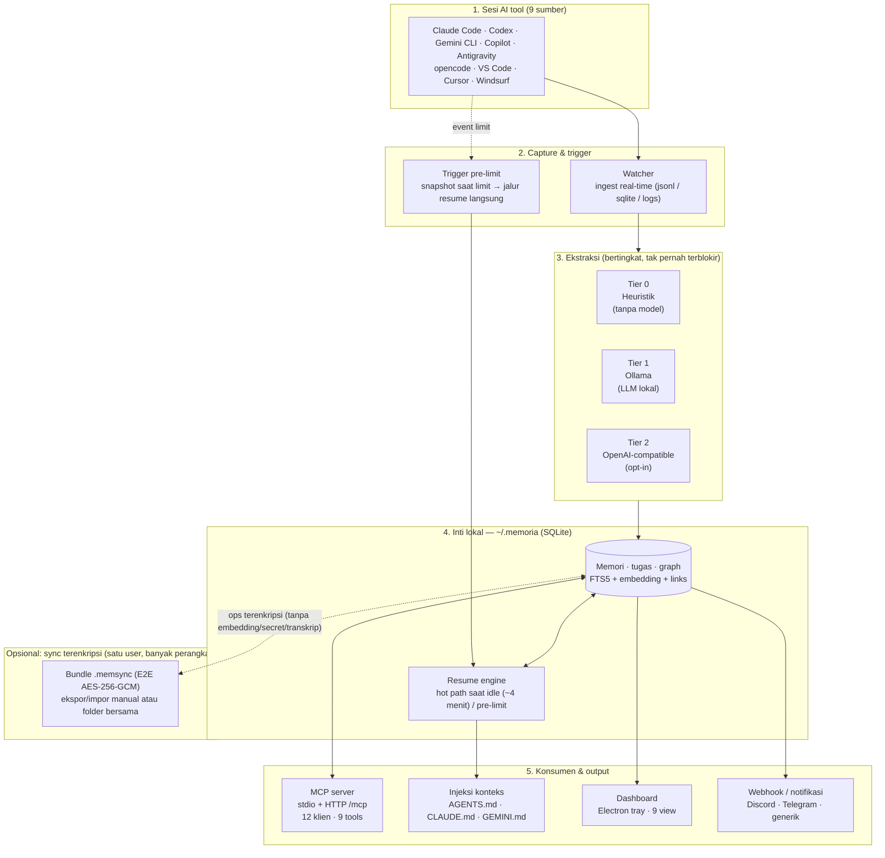

<div align="center">


# Memoria

**Second brain offline untuk semua AI coding tools — 100% lokal.**

Claude Code, Codex, Gemini CLI, Copilot, Antigravity, opencode, VS Code, Cursor, Windsurf —
satu memori bersama yang mengingat semua yang pernah Anda kerjakan dan menyalurkannya ke sesi berikutnya.

Tanpa cloud. Tanpa akun. Tidak ada data yang keluar dari komputer Anda.

<br>


[](https://github.com/xinzzu/Memoria/releases)
[](https://github.com/xinzzu/Memoria/actions)
[](LICENSE)
[](https://hub.xerj.org/contributors/xinzzu)
[](https://www.npmjs.com/package/@xinzzu/memoria)
[](https://registry.modelcontextprotocol.io/v0/servers?search=io.github.xinzzu/memoria)
[](https://glama.ai/mcp/servers/xinzzu/Memoria)
[](https://mcprush.com/xinzzu/memoria-mcp)

[English](README.md) · **Bahasa Indonesia** · [हिन्दी](README.hi.md)

```bash
npx @xinzzu/memoria@latest server   # lalu buka http://127.0.0.1:48210
```


<sub>Tangkap di Claude Code, lanjutkan di Codex: konteksnya ikut pindah. Kalau Memoria membantu, beri star supaya orang lain ikut menemukannya.</sub>

</div>

---

## Kenapa?

Setiap tool AI punya amnesia jangka pendek. Claude tidak ingat sesi kemarin. Codex tidak tahu
keputusan "grid 12 kolom" yang Anda sepakati di Gemini CLI. Dan saat limit habis di tengah
pekerjaan lalu pindah ke tool lain, Anda menjelaskan semuanya dari nol.

**Memoria menutup celah itu.** Ia mengawasi sesi AI tool Anda dan menyimpan apa yang benar-benar
tercatat di sana: daftar todo agen beserta statusnya, pertanyaan agen dan jawaban Anda, error
build/test beserta edit yang memperbaikinya, commit, dan laporan agen di akhir tiap giliran. Semua
itu disalurkan ke sesi berikutnya, di tool apa pun, otomatis.

Dibuat untuk alur **limit-hopping**: limit habis jam 14:30, buka tool lain jam 14:31 — tool baru
sudah tahu Anda sedang mengerjakan apa.

---

## Cara kerja



1. **Capture** — bekerja di tool AI mana pun; Memoria mengawasi sesi real-time (jsonl/sqlite/logs) dan, saat limit dilaporkan, mengambil snapshot kerja deterministik.
2. **Ekstraksi** — tier aktif (heuristik, Ollama, atau OpenAI-compatible) mengubah transkrip jadi memori (fakta, keputusan, tugas, error-fix), terindeks FTS5 + embedding + graph.
3. **Simpan lokal** — semua ada di SQLite lokal (`~/.memoria`); embedding/dialek tidak pernah dicampur antar model.
4. **Resume** — saat sesi idle (~4 menit) atau pre-limit, resume engine mengekstrak sesi terbaru lebih dulu dan menyuntikkan blok **SESSION RESUME** (idempoten) ke `AGENTS.md` / `CLAUDE.md` / `GEMINI.md`.
5. **Konsumsi** — 12 klien MCP bisa `recall`/`remember`/mengkurasi konteks via stdio atau HTTP bridge (`/mcp`), sementara dashboard dan webhook opt-in menampilkan state yang sama.
6. **Sync (opsional)** — replikasi pustaka antar perangkat dengan bundle `.memsync` terenkripsi E2E (manual/folder bersama); embedding, secret, settings, transkrip, dan path lokal tidak pernah ikut.

## Fitur utama

| | |
|---|---|
| 🔄 **Capture 9 tool** | Claude Code, Codex, opencode, Gemini CLI, Copilot, Antigravity, VS Code (Copilot Chat), Cursor, Windsurf |
| ⏸️ **Resume engine** | Blok SESSION RESUME otomatis di AGENTS.md / CLAUDE.md / GEMINI.md: tugas terbuka, keputusan terkunci, branch, file kotor |
| ⚡ **Trigger pre-limit** | Begitu tool AI melaporkan limit, snapshot kerja ditangkap dan blok resume diinjeksi **seketika** — sebelum kamu ditendang |
| 🧩 **MCP bridge — satu URL, semua tool** | MCP over HTTP di `http://127.0.0.1:48210/mcp` + registrasi satu klik ke 12 klien (Claude Code/Desktop, Codex, Gemini, opencode, Copilot CLI, Antigravity, Cursor, Windsurf, VS Code, Cline, Zed) |
| 🤖 **Memori yang bisa dikurasi agen** | 9 tool MCP: `recall` (scope proyek + budget token), `remember` (keputusan ADD/UPDATE/NOOP), `update_memory`, `forget`, `build_context`, `file_context` (apa yang diketahui tentang sebuah file sebelum diedit) |
| ✅ **Tab Tasks** | Semua janji/tugas dari sesi AI dalam satu checklist |
| 🧾 **Capture terstruktur** | Claude Code dan opencode: daftar todo, jawaban pertanyaan, hasil build/test yang dibaca dari **isi output**, edit file, dan commit menjadi memori dengan status aslinya — tanpa model |
| 🧠 **Tiered intelligence** | Jalan **tanpa model**: capture terstruktur + ekstraksi kalimat berbasis aturan. Kalimat hasil aturan tetap draft yang bisa dicari `recall`; yang disajikan otomatis hanya bukti terstruktur. Model Ollama atau OpenAI-compatible (opt-in) memberi ekstraksi kalimat yang bersih |
| 🔍 **Retrieval hibrid** | Keyword (FTS5 trigram) + embedding + graph centrality, toleran typo — terukur pada benchmark sintetis reproducible: **hit@5 92.8–100%** tanpa satu pun panggilan LLM (55% pada memori asli held-out, lihat di bawah) |
| 🧹 **Membersihkan diri** | Konsolidasi harian menggabungkan near-duplicate; filter noise menjaga inbox tetap jujur; bersih-bersih satu klik |
| 🕸️ **Graph memori** *(eksperimental)* | True 3D force graph: label prioritas degree dengan anti-overlap, fokus tetangga, zoom & pan |
| 📋 **Tasks & timeline** | Aktivitas per proyek + riwayat git + digest mingguan |
| 🔎 **Palette global** | Cari & salin memori dari mana saja; hotkey quick-note |
| 🔐 **Sync terenkripsi (opsional)** | Bundle `.memsync` E2E antar perangkat — manual atau folder bersama (Dropbox/iCloud/Syncthing/jaringan), tanpa server/embedding/secret/transkrip |
| 🔔 **Webhook & notifikasi** *(eksperimental)* | Alert opt-in ke Discord, Telegram, atau webhook JSON generik (digest, scan, approval, draft) |
| 🌐 **UI EN/ID** | English default, Bahasa Indonesia satu klik |
| 💾 **Backup & ekspor/impor** | Auto-backup (10 terakhir, WAL-safe), restore, ekspor Markdown / JSON / Obsidian vault — dan impor seluruh folder catatan kembali |

## Hasil terukur (v0.17.0)

Diukur pada pustaka nyata milik maintainer (sekitar 90 sesi Claude Code / opencode / Gemini,
sebagian besar berbahasa Indonesia). Kebenaran untuk todo diambil dari file sesi mentah. Label
lainnya dibuat secara buta oleh asisten AI (hanya dari isi, tanpa melihat keputusan pipeline)
dan belum diverifikasi independen, jadi anggap sebagai perkiraan.

| | Sebelum | v0.17.0 |
|---|---|---|
| Item todo agen tertangkap dengan status benar (548) | 0,2% | **100%** |
| Keputusan asli dari jawaban pertanyaan yang tertangkap (58) | 2 | **56** |
| Ketepatan yang disajikan ke agen tanpa diminta (resume, `project_context`) | 42% (kalimat berbasis aturan) | **96%** (bukti terstruktur; 81% tanpa todo) |
| `recall` hit@5 pada memori asli held-out | 24% | **55%** |
| Memori kedaluwarsa/basi di `project_context` | 16,9% | **1,7%** |
| Definisi tool + blok resume per sesi (mode lite) | ≈1.960 token | **≈730** |

Yang tidak bisa tanpa model: mengubah kalimat obrolan bebas menjadi memori yang bersih. Di data
yang sama tidak ada skor berbasis aturan yang mencapai ketepatan 70%, jadi kalimat itu tetap draft
yang belum ditinjau (bisa dicari, tidak pernah diinjeksi). Tambahkan Ollama atau endpoint
OpenAI-compatible untuk itu.

## Kebutuhan

| | Minimum | Catatan |
|---|---|---|
| Windows | 10/11 | Instalator `.exe` (NSIS) |
| Linux | distro .deb / AppImage | tray butuh libappindicator |
| macOS | 12+ | Apple Silicon & Intel |
| Node.js | ≥ 22.5 | hanya untuk build dari source |
| Ollama | **opsional** | upgrade untuk ekstraksi & embedding kelas LLM |
| RAM | 4 GB (8 GB direkomendasikan) | jalan CPU-only |

## Mulai cepat

### 1 · Instal

Unduh dari [rilis terbaru](https://github.com/xinzzu/Memoria/releases/latest):

| OS | Paket |
|---|---|
| Windows | `Memoria-Setup-<versi>.exe` |
| Linux | `memoria_<versi>_amd64.deb` (`sudo dpkg -i`) atau `Memoria-<versi>.AppImage` |
| macOS (Apple Silicon) | `Memoria-<versi>-arm64.dmg` |
| macOS (Intel) | `Memoria-<versi>-x64.dmg` |

Build macOS belum dinotarisasi: seret ke Applications, lalu klik kanan → Open saat pertama kali dibuka.

**Headless / CLI (server, WSL, devcontainer)** — tanpa Electron, butuh Node.js 22.5 atau lebih baru:

```bash
npx @xinzzu/memoria@latest server        # dashboard + API + MCP di http://127.0.0.1:48210
npm install -g @xinzzu/memoria           # atau install sekali, lalu: memoria server
memoria help                             # semua perintah
```

Memoria berjalan di tray dan langsung mulai menangkap.

### 2 · Jalan pertama — tanpa model

Saat pertama dibuka, asisten setup menampilkan AI tools yang ditemukan di komputermu,
menghubungkan yang kamu pilih, mengimpor sesi lamanya, lalu menunjukkan apa yang kini Memoria
ingat tentang proyek terbarumu — biasanya dalam satu menit.

Secara bawaan Memoria memakai **Tier 0**, tanpa model. Event terstruktur (todo, jawaban
pertanyaan, error→fix dari output build, commit) menjadi memori dengan status aslinya. Pesan
terakhir agen di tiap giliran menjadi laporan giliran berumur pendek untuk blok resume. Ekstraksi
kalimat berbasis aturan tetap berjalan, tapi hasilnya tetap draft: `recall` mencarinya, sedangkan
blok resume dan `project_context` hanya berisi bukti terstruktur. Noise dan duplikat diarsipkan
otomatis, setiap batch triage bisa dibatalkan, dan tidak ada yang perlu disetujui manual. Secret
(API key, token, private key berlabel, password) disensor sebelum disimpan. `memoria doctor`
memeriksa instalasi dan memberi tahu apa yang perlu diperbaiki.

Ingin ekstraksi & embedding kelas LLM?

```bash
ollama pull qwen2.5-coder:3b
ollama pull nomic-embed-text
```

Memoria mendeteksi otomatis (±5 menit) dan naik tier — tanpa konfigurasi ulang atau migrasi data.
Lebih suka LM Studio / llama.cpp / endpoint cloud? Settings → **Engine**.

### 3 · Daftarkan tool

Buka tab **Integrations** → registrasi satu klik per tool, atau via CLI:

```bash
npm install -g @xinzzu/memoria && memoria integrate claude
# dari checkout source: node dist/engine/index.js integrate claude
node dist/engine/index.js scan
```

**12 target didukung** (path config per docs resmi MCP clients): Claude Code, Claude Desktop,
Codex CLI, opencode, Gemini CLI, Copilot CLI, Antigravity, **Cursor** (via HTTP bridge),
**Windsurf**, **VS Code** (`"type": "http"`), **Cline**, **Zed**. Semua registrasi MERGE ke
config yang sudah ada — tidak ada yang ditimpa.

**Klien MCP stdio apa pun** bisa menjalankannya langsung dari npm (config yang sama dengan yang dipakai direktori MCP):

```json
{ "mcpServers": { "memoria": { "command": "npx", "args": ["-y", "@xinzzu/memoria", "mcp"] } } }
```

Memoria terdaftar di [MCP Registry resmi](https://registry.modelcontextprotocol.io/v0/servers?search=io.github.xinzzu/memoria) sebagai `io.github.xinzzu/memoria`, di [Glama](https://glama.ai/mcp/servers/xinzzu/Memoria) dan di [mcprush](https://mcprush.com/xinzzu/memoria-mcp).

Mau tanpa edit config? Semua klien MCP-capable bisa langsung menunjuk HTTP bridge:

```
url: http://127.0.0.1:48210/mcp
```

**9 tool MCP** siap pakai: `recall` (scope proyek + budget token), `remember` (keputusan
ADD/UPDATE/NOOP), `update_memory`, `forget`, `related`, `project_context` (indeks ringkas
secara bawaan), `get_memory` (teks penuh untuk id tertentu), `file_context` (error yang
pernah diperbaiki, keputusan, dan task terbuka yang menyebut sebuah file), dan
`build_context` (satu blok konteks siap-tempel dengan budget karakter). Keputusan lama
yang digantikan keputusan baru tentang hal yang sama ditandai usang dan tidak lagi masuk
blok resume.

Lalu mulai sesi baru dan minta agen Anda:

```
Recall the decisions from previous sessions in this project.
```

### 4 · CLI

```bash
node dist/engine/index.js scan
node dist/engine/index.js recall "kata kunci"
node dist/engine/index.js status
node dist/engine/index.js mcp
#                                     MCP over HTTP (jembatan antar-AI):
#                                     url: http://127.0.0.1:48210/mcp

# sync terenkripsi (satu user, banyak perangkat)
node dist/engine/index.js sync setup                         # buat group + recovery code
node dist/engine/index.js sync status
node dist/engine/index.js sync export --out ./bundle.memsync
node dist/engine/index.js sync import --in ./bundle.memsync --embed
node dist/engine/index.js sync folder set /path/ke/folder   # auto-sync via folder bersama
node dist/engine/index.js sync folder status
node dist/engine/index.js sync conflicts
```

## Resume engine — limit-hopping

Fitur inti: limit habis di tengah tugas lalu pindah tool, tool baru harus sudah paham konteksmu.

Saat aktivitas transkrip hening (~4 menit = sesi berakhir) — atau saat **trigger pre-limit**
mendeteksi laporan limit dari tool AI — Memoria menjalankan hot path: **scan → ekstrak sesi
terbaru dulu → injeksi**. Snapshot kerja deterministik (file disentuh, command, error, pesan
terakhir, branch/dirty files git) disimpan sebagai memori, lalu setiap file konteks proyek
mendapat blok idempoten bertanda:

```markdown
## SESSION RESUME
> claude · 14:32 · branch: feat/auth

**Open tasks:**
- [ ] finish the refresh-token endpoint in routes/api.ts

**Locked decisions (do not repeat):**
- JWT access tokens, 15 min — not sessions

**Dirty files (git):** src/auth/middleware.ts, src/auth/routes.ts

_Continue the work above — do not re-litigate locked decisions._
```

Disuntikkan ke **AGENTS.md** (Codex/opencode), **CLAUDE.md** (Claude Code) dan **GEMINI.md**
(Gemini CLI) — masing-masing bisa di-toggle di Settings — plus prompt lanjutan siap-paste
untuk tool yang tidak membaca file konteks.

## Tiered intelligence

| Tier | Engine | Butuh | Ekstraksi | Embedding |
|---|---|---|---|---|
| 2 | OpenAI-compatible | opt-in eksplisit + endpoint | ✓ kelas LLM | ✓ kelas model |
| 1 | Ollama | terpasang lokal | ✓ kelas LLM | ✓ kelas model |
| 0 | **Heuristik** (default) | **tidak ada** | rule-based + triage otomatis | hash lokal (256-dim) |

- Mode `Auto`: pakai Ollama saat berjalan **dan** model tersedia, selain itu heuristik. Tidak pernah menyentuh cloud.
- Perubahan engine langsung berlaku — tanpa restart.
- Dialek embedding tidak pernah dicampur: search, dedupe, dan graph tidak membandingkan vektor antar model.

## Sync terenkripsi (opsional)

Sinkronkan pustaka memori antar perangkat (user yang sama) dengan bundle end-to-end encrypted:

- **Transport:** ekspor/impor manual `.memsync` atau folder bersama yang dipantau Memoria
  (Dropbox, iCloud Drive, Syncthing, network share).
- **Kripto:** group key 256-bit + recovery code, bundle AES-256-GCM (HKDF per file, header
  terikat AAD), apply idempoten dengan HLC/LWW serta penanganan konflik/tombstone.
- **Tidak pernah disinkronkan:** embedding, secret/API key, settings, transkrip mentah, atau path lokal mesin.
- **Setup:** `memoria sync setup` (buat/join group) lalu export/import atau `memoria sync folder set`.
- **Dashboard:** Settings → **Sync** menampilkan status group/device, pending outbox, ekspor/impor
  terakhir, status/error folder, dan konflik terbaru (setup group, unlock passphrase, dan transfer
  bundle manual tetap via CLI).

> Hardening sync (rotasi/revokasi kunci, proteksi rollback, performance pass) direncanakan (M5).

## Dashboard

Sembilan view, English atau Bahasa Indonesia:

- **Overview** — ringkasan, kartu statistik, chart aktivitas 14 hari (pesan **dan** pembuatan memori — kerja heuristik ikut tampil), proyek terbaru, resume-ready, checklist setup
- **Memories** — pustaka lengkap: cari dengan highlight istilah, filter kind/proyek/topik/umur, inbox approval + bersih-bersih noise satu klik, arsip
- **Projects** — aktivitas per proyek, visibility draft pending, masuk ke timeline
- **Timeline** — jejak sesi + riwayat git
- **Handoff** — buat, salin, atau injeksikan blok resume
- **Tasks** — papan janji tugas dari sesi AI
- **Graph** — koneksi memori 3D, interaksi ala Obsidian
- **Integrations** — 12 target MCP, registrasi satu klik
- **Settings** — dua panel: sumber data, engine, perilaku, data/backup, notifikasi, dan sync

Global: `Ctrl/⌘ + Shift + M` quick note · `Ctrl/⌘ + Shift + Space` memory palette (bisa diubah di Settings).

## Privasi

- Capture, ekstraksi, dan pencarian — 100% lokal di `~/.memoria` secara default.
- Tier OpenAI-compatible adalah **satu-satunya** jalur data keluar dari mesin, dan hanya aktif
  jika Anda mengaktifkannya secara eksplisit (dengan peringatan privasi).
- API key dan secret webhook dienkripsi OS (Keychain di macOS / DPAPI di Windows) bila tersedia
  dan tidak pernah dikembalikan ke UI.
- Bundle sync terenkripsi E2E dan tidak pernah berisi embedding, secret, settings, transkrip, atau path lokal.
- Memori lama/kurang penting diarsipkan otomatis (forgetting curve); backup menyimpan 10 versi terakhir.

## Pengembangan

```bash
git clone https://github.com/xinzzu/Memoria && cd Memoria
npm install
npm run dev          # TypeScript watch mode
npm run build        # compile sekali
npm test             # build + node --test (66 tes)
npm run start        # Electron dev (engine di port 48210)
npm run check:ui     # audit selector + struktur UI
npm run dist         # installer Windows
npm run dist:linux   # AppImage + .deb
npm run dist:mac     # .dmg + .zip (khusus macOS)
```

> Tes berjalan terhadap `dist/` (bukan `src/`). Untuk server terisolasi gunakan
> `MEMORIA_DATA_DIR=$(mktemp -d)` dan jangan sentuh DB `~/.memoria` asli atau port `48210`.

### Struktur proyek

```
src/
├── engine/
│   ├── config.ts              # sumber data & konfigurasi tool per OS
│   ├── http.ts                # API lokal (127.0.0.1:48210) + dashboard statis
│   ├── ingest/                # watcher + parser per tool (claude, codex, vscdb, …)
│   ├── extract/               # tier provider, heuristik, ollama, openai-compat,
│   │                          # entitas, topik, task lifecycle, dedupe
│   ├── retrieve/search.ts     # retrieval hibrid (FTS5 trigram + embedding + centrality)
│   ├── retrieve/contextblock.ts # build_context — blok konteks siap-tempel
│   ├── sync/                  # sync E2E terenkripsi (kunci, bundle, export/apply,
│   │                          # transport folder bersama, CLI, embed backfill)
│   ├── mcp/server.ts          # MCP server (stdio + HTTP bridge, 9 tools)
│   ├── store/                 # SQLite (node:sqlite), migrasi v1-v7, backup, secure storage
│   ├── extract/snapshot.ts    # F4 snapshot kerja zero-AI + trigger pre-limit
│   ├── extract/consolidate.ts # konsolidasi near-duplicate harian (zero-LLM)
│   ├── import/markdown.ts     # impor folder catatan Obsidian / memory bank
│   ├── notify/webhook.ts      # notifikasi opt-in Discord/Telegram/generic
│   ├── handoff.ts             # resume engine + injeksi multi-file
│   └── index.ts               # entri CLI
├── electron/main.ts           # tray, dashboard, hotkey global
web/                           # UI dashboard (vanilla JS, i18n EN/ID)
scripts/                       # generator ikon, audit UI, benchmark search,
                               # eval retrieval (hit@1/@5, MRR)
docs/                          # dokumen desain (mis. sync-design.md)
tests/                         # suite node --test (berjalan terhadap dist/)
ROADMAP.md                     # rencana eksekusi & posisi terkini
CHANGELOG.md                   # catatan rilis
```

### Teknologi

TypeScript · Node 24 (`node:sqlite`, FTS5) · Electron 37 · chokidar · MCP SDK · vanilla JS dashboard

## FAQ

**Apakah data saya keluar dari komputer?**
Tidak. Capture, ekstraksi, dan pencarian berjalan lokal di `~/.memoria`. Tier cloud hanya aktif
jika Anda mengonfigurasinya secara eksplisit.

**Bisa sync antar perangkat?**
Bisa. Buat/join sync group (`memoria sync setup`), lalu ekspor/impor bundle `.memsync` manual
atau arahkan Memoria ke folder bersama (Dropbox/iCloud/Syncthing/network share) via CLI atau
Settings → Sync. Bundle terenkripsi E2E dan tidak pernah berisi embedding, secret, settings,
transkrip, atau path lokal.

**Apakah saya butuh Ollama?**
Tidak. Tanpa model Anda tetap mendapat capture terstruktur (todo, jawaban pertanyaan, error→fix,
commit), laporan giliran, blok resume, dan pencarian. Kalimat obrolan bebas tetap draft yang belum
ditinjau, karena ekstraksi berbasis aturan belum cukup tepat untuk disajikan otomatis. Ollama
adalah jalur upgrade untuk ekstraksi kalimat yang bersih, terdeteksi otomatis saat terpasang.

**Tool apa saja yang didukung?**
Claude Code, Codex, opencode, Gemini CLI, Copilot, Antigravity — plus capture VS Code, Cursor,
Windsurf, dan endpoint generik `/api/import`.

**Apakah memori akan tumbuh selamanya?**
Tidak, tiga lapis: memori lama/kurang penting diarsipkan otomatis (forgetting curve), konsolidasi
harian menggabungkan near-duplicate, dan noise tool (status line, badge, puing markdown) disaring
saat ekstraksi — lengkap dengan tombol bersih-bersih untuk backlog tersimpan.

**Apa yang terjadi saat limit AI tool saya habis?**
Memoria mendeteksi pesan limit di transkrip dan seketika: menyimpan snapshot kerja, mengekstrak
sesi dengan prioritas, dan menginjeksikan blok resume ke file konteks — sebelum kamu ditendang.
Pindah tool, dan sesi berikutnya sudah tahu apa yang sedang dikerjakan. Opsional: webhook
memberi tahu lewat HP.

**Bisa hubungkan tool AI tanpa mengedit file config?**
Bisa — semua klien MCP-capable cukup menunjuk HTTP bridge:
`http://127.0.0.1:48210/mcp`. Atau pakai registrasi satu klik untuk 12 klien
di tab Integrations.

**Bisa dapat notifikasi di luar dashboard?**
Bisa, opt-in. Konfigurasikan Discord, Telegram, atau webhook JSON generik di Settings →
Notifications untuk event digest/scan/approval/draft. Secret webhook disimpan terenkripsi bila tersedia.

**Bahasa UI?**
English secara default; Bahasa Indonesia satu klik di Settings.

## Dokumentasi

- [README.md](README.md) — dokumentasi lengkap (English)
- [ROADMAP.md](ROADMAP.md) — rencana eksekusi & posisi terkini
- [CHANGELOG.md](CHANGELOG.md) — catatan rilis
- [docs/sync-design.md](docs/sync-design.md) — desain & status sync terenkripsi

## Lisensi

MIT © 2026 Memoria

---

_Dibuat di Indonesia — supaya agent AI Anda tidak pernah lupa lagi._
