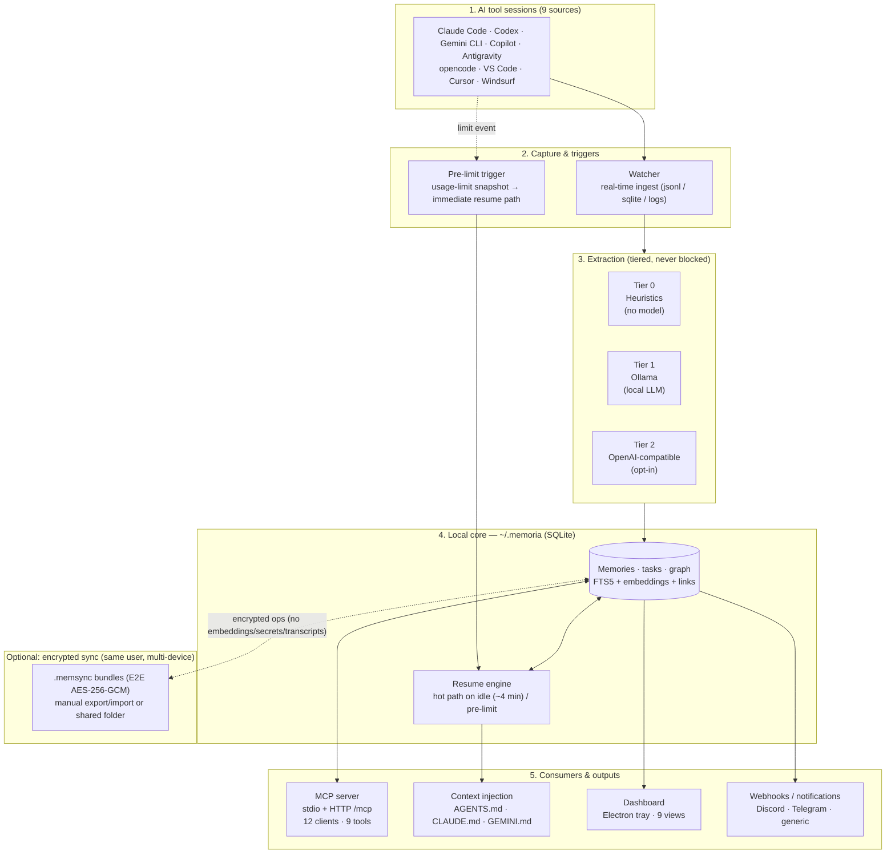

<div align="center">


# Memoria

**A second brain for every AI coding tool — 100% local.**

Claude Code, Codex, Gemini CLI, Copilot, Antigravity, opencode, VS Code, Cursor, Windsurf —
one shared memory that remembers everything you've ever done and feeds it into your next session.

No cloud. No account. Nothing leaves your computer.

<br>


[](https://github.com/xinzzu/Memoria/releases)
[](https://github.com/xinzzu/Memoria/actions)
[](LICENSE)
[](https://hub.xerj.org/contributors/xinzzu)
[](https://www.npmjs.com/package/@xinzzu/memoria)
[](https://registry.modelcontextprotocol.io/v0/servers?search=io.github.xinzzu/memoria)
[](https://glama.ai/mcp/servers/xinzzu/Memoria)
[](https://mcprush.com/xinzzu/memoria-mcp)

**English** · [Bahasa Indonesia](README.id.md) · [हिन्दी](README.hi.md)

```bash
npx @xinzzu/memoria@latest server   # then open http://127.0.0.1:48210
```


<sub>Capture in Claude Code, continue in Codex: the context comes with you. If Memoria saves you a re-explain, a star helps others find it.</sub>

</div>

---

## Why?

Every AI tool has short-term amnesia. Claude doesn't remember yesterday's session. Codex doesn't
know you decided "12-column grid" in Gemini CLI. And when you hit your usage limit mid-task and
switch to another tool, you explain everything all over again.

**Memoria closes that gap.** It watches your AI tool sessions, extracts what matters — facts,
decisions, tasks, fixed errors — and hands it to the next session, in any tool, automatically.

Built for the **limit-hopping** workflow: hit your limit at 14:30, open a different tool at
14:31 — and it already knows what you were working on.

---

## How it works



1. **Capture** — work in any AI tool; Memoria watches sessions in real time (jsonl/sqlite/logs) and, on a reported usage limit, takes a deterministic work snapshot.
2. **Extract** — the active tier (heuristics, Ollama, or OpenAI-compatible) turns transcripts into memories (facts, decisions, tasks, fixes), indexed by FTS5 + embeddings + graph links.
3. **Store locally** — everything lives in a local SQLite brain (`~/.memoria`); embeddings/dialects are never mixed across models.
4. **Resume** — when a session goes idle (~4 min) or pre-limit fires, the resume engine extracts the newest session first and injects an idempotent **SESSION RESUME** block into `AGENTS.md` / `CLAUDE.md` / `GEMINI.md`.
5. **Consume** — any of the 12 MCP clients can `recall`/`remember`/curate context via stdio or the HTTP bridge (`/mcp`), while the dashboard and opt-in webhooks surface the same state.
6. **Sync (optional)** — replicate the library across your devices with end-to-end encrypted `.memsync` bundles (manual or shared folder); embeddings, secrets, settings, transcripts, and local paths never sync.

## Highlights

| | |
|---|---|
| 🔄 **Capture from 9 tools** | Claude Code, Codex, opencode, Gemini CLI, Copilot, Antigravity, VS Code (Copilot Chat), Cursor, Windsurf |
| ⏸️ **Resume engine** | A SESSION RESUME block auto-injected into AGENTS.md / CLAUDE.md / GEMINI.md: open tasks, locked decisions, current branch, dirty files |
| ⚡ **Pre-limit trigger** | The moment your AI tool reports a usage limit, Memoria captures a work snapshot (files, commands, git state) and injects the resume block **immediately** — before you're kicked out |
| 🧩 **MCP bridge — one URL, every tool** | MCP over HTTP at `http://127.0.0.1:48210/mcp` + one-click registration into 12 clients (Claude Code/Desktop, Codex, Gemini, opencode, Copilot CLI, Antigravity, Cursor, Windsurf, VS Code, Cline, Zed) |
| 🤖 **Self-editing memory** | Agents don't just read the brain — they curate it: `recall` (project-scoped, token budget), `remember` (ADD/UPDATE/NOOP decisions), `update_memory`, `forget`, `build_context`, `file_context` (what is known about a file before editing it) |
| ✅ **Tasks view** | Every task your AI sessions promised, in one checkable board |
| 🧠 **Tiered intelligence** | Works with **no model at all** (heuristics + automatic triage, no manual approval), with Ollama, or any OpenAI-compatible endpoint (LM Studio, llama.cpp, vLLM, cloud — opt-in) |
| 🔍 **Hybrid retrieval** | Keyword (FTS5 trigram) + embeddings + graph centrality, fuzzy-tolerant — measured on a reproducible benchmark: **hit@5 92.8–100%** with zero LLM calls |
| 🕸️ **Memory graph** | True 3D force graph (2D fallbacks), degree-priority labels with anti-overlap, hover focus on neighbors, zoom & pan |
| 📋 **Tasks & timeline** | Per-project activity + git history + weekly digest |
| 🔎 **Global palette** | Search & copy memories from anywhere; quick-note hotkey |
| 👥 **Team project brain** | Opt-in `.memoria/brain.md` in the repo: decisions, conventions and fixes shared through git, reviewable in PRs, imported back as team memories |
| 🔐 **Encrypted sync (optional)** | E2E encrypted `.memsync` bundles across your devices — manual or shared folder (Dropbox/iCloud/Syncthing/network), no server, no embeddings/secrets/transcripts |
| 🔔 **Webhooks & notifications** | Opt-in alerts to Discord, Telegram, or generic JSON webhooks (digest, scan, approvals, pending drafts) |
| 🌐 **EN / ID interface** | English-first, Bahasa Indonesia one click away |
| 🧹 **Self-cleaning** | Daily consolidation merges near-duplicates; tool-noise filter keeps the review inbox honest; one-click noise cleanup |
| 💾 **Backups & export** | Auto-backup (last 10, WAL-safe), restore, export to Markdown / JSON / Obsidian vault — and import a whole notes folder back in |

## Requirements

| | Minimum | Notes |
|---|---|---|
| Windows | 10/11 | `.exe` installer (NSIS) |
| Linux | .deb distros / AppImage | tray needs libappindicator |
| macOS | 12+ | Apple Silicon & Intel |
| Node.js | ≥ 22.5 | only when building from source |
| Ollama | **optional** | upgrade path for LLM-grade extraction & embeddings |
| RAM | 4 GB (8 GB recommended) | works CPU-only |

## Quickstart

### 1 · Install

Download from the [latest release](https://github.com/xinzzu/Memoria/releases/latest):

| OS | Package |
|---|---|
| Windows | `Memoria-Setup-<version>.exe` |
| Linux | `memoria_<version>_amd64.deb` (`sudo dpkg -i`) or `Memoria-<version>.AppImage` |
| macOS (Apple Silicon) | `Memoria-<version>-arm64.dmg` |
| macOS (Intel) | `Memoria-<version>-x64.dmg` |

macOS builds are not notarized yet: drag to Applications, then right-click → Open the first time.

Memoria lives in the tray and starts capturing automatically.

**Headless / CLI (servers, WSL, devcontainers)** — no Electron, Node.js 22.5 or newer:

```bash
npx @xinzzu/memoria@latest server        # dashboard + API + MCP on http://127.0.0.1:48210
npm install -g @xinzzu/memoria           # or install once, then: memoria server
memoria help                             # all commands
```

### 2 · First run — no model required

On first launch a setup assistant lists the AI tools found on your machine, connects the ones
you pick, imports their past sessions, and shows what Memoria now remembers about your recent
projects — usually within a minute.

Out of the box, Memoria runs on **Tier 0 heuristics**: sessions are captured and turned into
memories. Noise (tool output, shell listings, bare paths) and duplicates are archived
automatically, strong signals become active, and the few uncertain drafts are re-checked daily —
you never have to approve thousands of items by hand. Every triage batch can be undone. Search,
tasks, timeline, graph, handoff — everything works. Secrets (API keys, tokens, private keys,
passwords) are redacted before anything is stored.

Want LLM-grade extraction and embeddings later?

```bash
ollama pull qwen2.5-coder:3b
ollama pull nomic-embed-text
```

Memoria detects them automatically (within ~5 minutes) and moves up a tier — nothing to
reconfigure, no data migrations. Prefer LM Studio / llama.cpp / a cloud endpoint instead?
Settings → **Engine**.

### 3 · Register your tools

Open the **Integrations** tab → one-click registration per tool, or via CLI:

```bash
npm install -g @xinzzu/memoria && memoria integrate claude
# from a source checkout: node dist/engine/index.js integrate claude
```

**12 supported targets** (config paths per the official MCP clients docs):
Claude Code (`~/.claude.json`), Claude Desktop (`claude_desktop_config.json`),
Codex CLI (`~/.codex/config.toml`), opencode, Gemini CLI (`~/.gemini/settings.json`),
Copilot CLI (`~/.copilot/mcp-config.json`), Antigravity, **Cursor** (`~/.cursor/mcp.json`
via the HTTP bridge), **Windsurf** (`~/.codeium/windsurf/mcp_config.json`),
**VS Code** (`~/.vscode/mcp.json`, `"type": "http"`), **Cline** (globalStorage
settings), **Zed** (`settings.json`). All registrations merge into your existing
configs — nothing is overwritten.

**Any stdio MCP client** can run it straight from npm (the same config the MCP directories use):

```json
{ "mcpServers": { "memoria": { "command": "npx", "args": ["-y", "@xinzzu/memoria", "mcp"] } } }
```

Memoria is listed on the [official MCP Registry](https://registry.modelcontextprotocol.io/v0/servers?search=io.github.xinzzu/memoria) as `io.github.xinzzu/memoria`, on [Glama](https://glama.ai/mcp/servers/xinzzu/Memoria) and on [mcprush](https://mcprush.com/xinzzu/memoria-mcp).

Prefer zero config? Any MCP-capable tool can also point straight at the HTTP bridge:

```
url: http://127.0.0.1:48210/mcp
```

Then start a new session and tell your agent:

```
Recall the decisions from previous sessions in this project.
```

**Nine MCP tools** ship out of the box: `recall` (project-scoped, token budget),
`remember` (ADD/UPDATE/NOOP smart decisions), `update_memory`, `forget`,
`related`, `project_context` (compact index by default), `get_memory` (full text
for selected ids), `file_context` (fixed errors, decisions and open tasks that
mention a file), and `build_context` (one ready-to-paste context block with a
character budget). When a newer decision replaces an older one about the same
subject, the old one is marked superseded and drops out of the resume block.

**Claude Code hooks** are installed together with the MCP server: a new Claude Code session
starts with the project's resume context, and each turn, compaction, and session end is
imported immediately (`memoria hooks install | remove | status`).

**Beyond coding tools:** import your ChatGPT or Claude history (the data-export `.zip`) and
keep memories in an Obsidian vault in both directions — edit or delete a note there and
Memoria follows.

### 4 · CLI

```bash
node dist/engine/index.js scan      # scan all tools now
node dist/engine/index.js recall "docker issue"
node dist/engine/index.js status
node dist/engine/index.js mcp       # MCP stdio mode
#                                    MCP over HTTP (bridge for any AI tool):
#                                    url: http://127.0.0.1:48210/mcp

# encrypted sync (same user, multiple machines)
node dist/engine/index.js sync setup                         # create group + recovery code
node dist/engine/index.js sync status
node dist/engine/index.js sync export --out ./bundle.memsync
node dist/engine/index.js sync import --in ./bundle.memsync --embed
node dist/engine/index.js sync folder set /path/to/shared    # auto-sync via shared folder
node dist/engine/index.js sync folder status
node dist/engine/index.js sync conflicts
```

## The resume engine — limit-hopping

The core feature. You hit a usage limit mid-task and switch tools; the new tool should already
know what you were doing.

When transcript activity goes quiet (~4 minutes = session ended), Memoria runs the hot path:
**scan → extract the newest session first → inject**. Within ~5 minutes, every context
convention file in the project contains an idempotent, marked block:

And when your AI tool itself reports a usage limit, the **pre-limit trigger** fires the same
pipeline **immediately** — a deterministic **work snapshot** (files touched, commands run,
errors, last message, git branch/dirty files) is saved as a memory, the newest session is
extracted with priority, and the resume block is injected before you're kicked out. You can
even get a webhook ping on your phone: *"resume brain is ready — switch tools whenever
you're ready."*

```markdown
## SESSION RESUME
> claude · 14:32 · branch: feat/auth

**Open tasks:**
- [ ] finish the refresh-token endpoint in routes/api.ts

**Locked decisions (do not repeat):**
- JWT access tokens, 15 min — not sessions

**Dirty files (git):** src/auth/middleware.ts, src/auth/routes.ts

_Continue the work above — do not re-litigate locked decisions._
```

Injected into **AGENTS.md** (Codex/opencode), **CLAUDE.md** (Claude Code) and **GEMINI.md**
(Gemini CLI) — each target toggleable in Settings — plus a one-click **resume prompt** for
tools that don't read context files.

## Tiered intelligence

| Tier | Engine | Needs | Extraction | Embeddings |
|---|---|---|---|---|
| 2 | OpenAI-compatible | explicit opt-in + endpoint | ✓ LLM-grade | ✓ model-grade |
| 1 | Ollama | installed locally | ✓ LLM-grade | ✓ model-grade |
| 0 | **Heuristics** (default) | **nothing** | rule-based + auto-triage | local hash (256-dim) |

- `Auto` mode: Ollama when it's running **and** the model exists, otherwise heuristics.
  Never touches the cloud.
- Engine changes apply instantly — no restart.
- Embedding dialects are never mixed: search, dedupe and the graph never compare vectors
  across models.

## Encrypted sync (optional)

Sync the same memory library across your machines (same user) with end-to-end encrypted bundles:

- **Transport:** manual `.memsync` export/import or a shared folder watched by Memoria
  (Dropbox, iCloud Drive, Syncthing, network share).
- **Crypto:** 256-bit group key + recovery code, AES-256-GCM bundles (HKDF per file, AAD-bound
  header), idempotent apply with HLC/LWW and conflict/tombstone handling.
- **Never synced:** embeddings, secrets/API keys, settings, raw transcripts, or machine-local paths.
- **Setup:** `memoria sync setup` (create/join group) then export/import or `memoria sync folder set`.
- **Dashboard:** Settings → **Sync** shows group/device status, pending outbox, last
  export/import, shared-folder state/error, and recent conflicts (group setup, passphrase unlock,
  and manual bundle transfer remain CLI).

> Sync hardening (key rotation/revocation, rollback protection, performance pass) is planned (M5).

## Dashboard

Nine views, English or Bahasa Indonesia:

- **Overview** — greeting, pastel stat cards, 14-day activity chart (messages **and** memory
  creations — heuristic work included), "Recently worked on", resume-ready projects, setup
  checklist
- **Memories** — full library: search with term highlighting, kind/project/topic/age filters,
  approval inbox with one-click noise cleanup, archive
- **Projects** — per-project activity, pending-draft visibility, click through to timelines
- **Timeline** — session trail + git history
- **Handoff** — generate, copy, or inject the resume block
- **Tasks** — the AI-session promise board
- **Graph** — memory connections in 3D, Obsidian-style interactions, anti-overlap labels
- **Integrations** — 12 MCP targets, one-click registration
- **Settings** — two-pane layout: data sources, engine tiers, behavior, data/backup,
  notifications, and sync

Global: `Ctrl/⌘ + Shift + M` quick note · `Ctrl/⌘ + Shift + Space` memory palette
(both rebindable in Settings).

## Privacy

- Capture, extraction, search — 100% local in `~/.memoria` by default.
- The OpenAI-compatible tier is the **only** way data leaves the machine, and it requires
  explicit opt-in with a visible privacy warning.
- API keys and webhook secrets are always encrypted and never returned to the UI: Electron
  uses safeStorage; the CLI / npm mode uses AES-256-GCM with a master key kept in the macOS
  Keychain, Linux Secret Service (`secret-tool`), or Windows DPAPI, falling back to an
  owner-only key file.
- Secrets are redacted from transcripts before storage; `<private>…</private>` blocks and
  excluded projects are never stored.
- The local API (`127.0.0.1:48210`) requires a token. The desktop app passes it
  automatically; for headless mode `memoria server` prints a one-time sign-in link, and
  `memoria token` prints it again. Data folder and database files are owner-only (0700/0600).
- Encrypted sync bundles are end-to-end encrypted and never include embeddings, secrets,
  settings, transcripts, or machine-local paths.
- Stale, low-importance memories are archived automatically (forgetting curve); backups keep
  the last 10 versions.

## Development

```bash
git clone https://github.com/xinzzu/Memoria && cd Memoria
npm install
npm run dev          # TypeScript watch mode
npm run build        # compile once
npm test             # build + node --test (66 tests)
npm run start        # Electron dev (engine on port 48210)
npm run check:ui     # audit UI selectors + structure
npm run dist         # Windows installer
npm run dist:linux   # AppImage + .deb
npm run dist:mac     # .dmg + .zip (macOS only)
```

> Tests run against `dist/` (not `src/`). For an isolated server, use
> `MEMORIA_DATA_DIR=$(mktemp -d)` and never touch the live `~/.memoria` DB or port `48210`.

### Project structure

```
src/
├── engine/
│   ├── config.ts              # per-OS data sources & tool config
│   ├── http.ts                # local API (127.0.0.1:48210) + static dashboard
│   ├── ingest/                # watcher + per-tool parsers (claude, codex, vscdb, …)
│   ├── extract/               # provider tiers, heuristics, ollama, openai-compat,
│   │                          # entities, topics, task lifecycle, dedupe
│   ├── retrieve/search.ts     # hybrid retrieval (FTS5 trigram + embeddings + centrality)
│   ├── retrieve/contextblock.ts # build_context — one ready-to-paste context block
│   ├── sync/                  # E2E encrypted sync (keys, bundles, export/apply,
│   │                          # shared-folder transport, CLI, embed backfill)
│   ├── mcp/server.ts          # MCP server (stdio + HTTP bridge, 9 tools)
│   ├── store/                 # SQLite (node:sqlite), migrations v1-v7, backup, secure storage
│   ├── extract/snapshot.ts    # F4 zero-AI work snapshots + pre-limit trigger
│   ├── extract/consolidate.ts # daily near-duplicate merging (zero-LLM)
│   ├── import/markdown.ts     # Obsidian vault / notes folder import
│   ├── notify/webhook.ts      # opt-in Discord/Telegram/generic notifications
│   ├── handoff.ts             # resume engine + multi-file injection
│   └── index.ts               # CLI entry
├── electron/main.ts           # tray, dashboard, global hotkeys
web/                           # dashboard UI (vanilla JS, EN/ID i18n)
scripts/                       # icon generator, UI selector audit, search bench,
                               # retrieval eval (hit@1/@5, MRR)
docs/                          # design docs (e.g. sync-design.md)
tests/                         # node --test suites (run against dist/)
ROADMAP.md                     # execution plan & current position
CHANGELOG.md                   # release notes
```

### Tech

TypeScript · Node 24 (`node:sqlite`, FTS5) · Electron 37 · chokidar · MCP SDK · vanilla JS dashboard

## FAQ

**Does my data leave my computer?**
No. Capture, extraction and search all run locally in `~/.memoria`. The cloud tier exists but
only activates if you explicitly configure it.

**Can I sync between machines?**
Yes. Create/join a sync group (`memoria sync setup`), then export/import `.memsync` bundles
manually or point Memoria at a shared folder (Dropbox/iCloud/Syncthing/network share) via CLI
or Settings → Sync. Bundles are end-to-end encrypted and never include embeddings, secrets,
settings, transcripts, or machine-local paths.

**Do I need Ollama?**
No. Heuristics work with zero models and triage their own output automatically. Ollama is
an upgrade path, detected automatically when you install it.

**Which tools are supported?**
Claude Code, Codex, opencode, Gemini CLI, Copilot, Antigravity — plus VS Code, Cursor and
Windsurf capture, and a generic `/api/import` endpoint for anything else.

**Will memories grow forever?**
No, three ways: stale low-importance memories are archived automatically (forgetting curve),
a daily consolidation pass merges near-duplicates, and tool-noise (status lines, badges,
markdown debris) is filtered out of extraction — with a one-click cleanup for the stored
backlog.

**What happens when I hit my AI tool's usage limit?**
Memoria detects the limit message in the transcript and immediately captures a work snapshot,
extracts the session with priority, and injects the resume block into your context files —
before you're kicked out. Switch tools and the next session already knows what you were
doing. Optionally, a webhook pings your phone.

**Can I connect an AI tool without editing config files?**
Yes — any MCP-capable client can point at the HTTP bridge: `http://127.0.0.1:48210/mcp`.
Or use one-click registration for 12 clients in the Integrations tab.

**Can Memoria notify me outside the dashboard?**
Yes, opt-in. Configure Discord, Telegram, or a generic JSON webhook in Settings → Notifications
for digest/scan/approval/draft events. Webhook secrets are stored encrypted when available.

**UI language?**
English by default; Bahasa Indonesia one click away in Settings.

## Documentation

- [ROADMAP.md](ROADMAP.md) — execution plan, phases and current position
- [CHANGELOG.md](CHANGELOG.md) — release notes
- [docs/sync-design.md](docs/sync-design.md) — encrypted sync design and status

## License

MIT © 2026 Memoria

---

_Made in Indonesia — so your AI agents never forget again._
